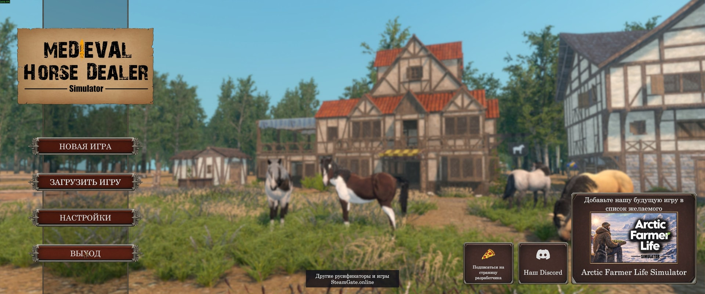
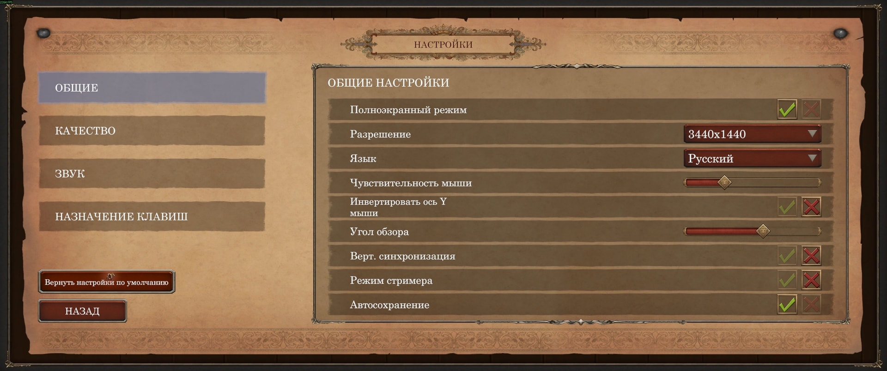
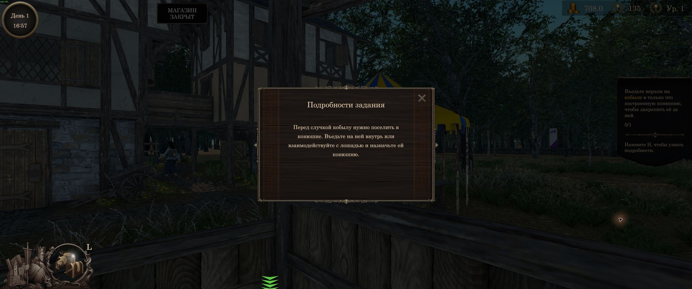

# Русификатор Medieval Horse Dealer Simulator

Исправленный русский перевод для Steam-версии Medieval Horse Dealer Simulator. В игре уже есть русский язык; этот бесплатный мод исправляет его ошибки и делает термины единообразными.

**[Скачать русификатор](https://github.com/sincess1/medieval-horse-dealer-simulator-rusifikator/releases/latest)** — ZIP, 1,06 МиБ · версия 1.0.0 · Steam build 25627094 · [зеркало и инструкция](https://steamgate.online/ru/blog/medieval-horse-dealer-simulator-rusifikator?utm_source=github&utm_medium=readme&utm_campaign=medieval-horse-dealer)

Сделан командой [SteamGate.online](https://steamgate.online/ru?utm_source=github&utm_medium=readme&utm_campaign=medieval-horse-dealer).

## Что исправлено

Проверены все **6 344 строки** основной таблицы перевода, **5 286 строк изменены**. Исправлены интерфейс, обучение, задания, диалоги, события, торговля, разведение и тренировки лошадей, характеристики, постройки, снаряжение и наёмники. Дополнительно переведены отдельные заголовки окон и подписи уровня, опыта и времени.

## Качество перевода

Названия характеристик и построек приведены к единому словарю. Проверки контролируют сохранность чисел, подставляемых значений, тегов оформления и переносов строк. В игре проверены меню, настройки, переключение языков, загрузка сохранения, обучение, подсказка задания и пауза. Все строки подряд в игровом прохождении не проверялись. Озвучка не меняется.

## Установка

1. **Закройте игру и распакуйте ZIP в её папку**, рядом с `Medieval Horse Dealer Simulator.exe`. Папку можно открыть через Steam: правый клик по игре → «Управление» → «Просмотреть локальные файлы».
2. **Запустите игру и выберите «Русский»** в настройках языка.

Архив содержит DLL-плагин перевода, загрузчик **BepInEx 5.4.23.5 x64**, инструкцию и лицензии зависимостей. Отдельного установщика нет. Если BepInEx уже установлен, скопируйте только папку `BepInEx\plugins\HorseRussian`, сохранив свой загрузчик.

## Скриншот задания

## Вопросы и ответы

**Для какой версии игры?**

Проверено на Windows x64, Steam AppID 3503710, build 25627094. Работа с другими модами и будущими версиями игры не проверялась.

**Что меняется в файлах игры и сохранениях?**

Исходные игровые архивы не заменяются. Плагин подменяет русские строки при запуске и не редактирует сохранения. Другие языки сохраняются.

**Что будет после обновления игры?**

Изменённые и новые исходные строки сохраняют штатный перевод, пока мод не обновлён. Совместимость загрузчика и интерфейса с будущими версиями не гарантируется. Актуальная версия находится в [Releases](https://github.com/sincess1/medieval-horse-dealer-simulator-rusifikator/releases).

**Почему в меню кнопки SteamGate.online?**

Мод бесплатный. Взамен он добавляет отдельные кнопки SteamGate в главном меню и паузе. Сайт открывается только по нажатию. Кнопки разработчика сохранены.

**Как удалить перевод?**

Закройте игру и удалите папку `BepInEx\plugins\HorseRussian`. Вернётся штатный русский перевод. Если других модов нет и BepInEx установлен только для этого перевода, можно также удалить папку `BepInEx`, файлы `winhttp.dll` и `doorstop_config.ini`.

**Куда сообщать об ошибках?**

Создайте [обращение](https://github.com/sincess1/medieval-horse-dealer-simulator-rusifikator/issues) с текстом ошибки или скриншотом, версией мода и номером сборки игры.

## English

Free Russian localization revision for Medieval Horse Dealer Simulator. Reviews all 6,344 built-in localization strings and revises 5,286 of them, with consistent terminology and additional UI label fixes. Windows Steam build 25627094; requires selecting Russian in the game settings. The ZIP includes a DLL plugin and BepInEx 5.4.23.5 x64. Original game archives and saves are preserved. A SteamGate link button is added to the main and pause menus.

## Ищут также

Medieval Horse Dealer Simulator русификатор, исправленный русский перевод, русский язык, перевод симулятора торговца лошадьми, Medieval Horse Dealer Simulator Russian translation, localization fix, BepInEx mod.

Неофициальный мод. Для игры нужна собственная копия Medieval Horse Dealer Simulator. Права на игру принадлежат её правообладателям; лицензии компонентов включены в архив.
